  

# Controlled experiment execution

Run sequential stages and long-lived services with explicit inputs, settings,
timeouts, and retry policies. The server owns execution; closing the CLI does
not stop the experiment. Services start before the stages and remain available
across stages and pauses.

## Start and control a run

First [prepare modules, a template, and a run-mode server](basic_dag.md).
Wait for server readiness before submitting work. Commands below use the default
API address; put `--config <cli-json>` or `--url <api-url>` before the subcommand
when selecting another server.

| CLI command | Behavior |
| --- | --- |
| `run --template <path> --delayed-start --wait` | Prepare the experiment and services, then wait before the first stage. |
| `pause --wait` | Wait for the active attempt to finish; services remain alive. |
| `step --wait` | Execute the next stage from an idle pause, then pause again. |
| `resume --wait` | Continue normal execution. |
| `stop --wait` | Interrupt active work and stop owned services. |
| `rerun stage --position 1 --wait` | Rerun a stage from a permitted paused state. |
| `retry 1 --wait` | Restart service 1 from a permitted paused state. |
| `move 2 --wait` | Move the paused stage pointer to position 2. |
| `reset-retries stage 1 --wait` | Reset that stage's retry counter while paused. |

Run these subcommands through `uv run python -B cli.py`. Positions are one-based.
A service retry and a stage rerun are different operations. The runtime checks
the current phase and may reject a command. Moving or rerunning can change
available input; each module must validate it.

`--wait` waits for the command result, not completion of the whole experiment.
Inspect `status` to determine whether execution has finished. If a command is
still pending, query `result <command-id> --wait` instead of submitting it again.
See the [CLI reference](cli.md#execute-and-control-experiments) and
[debugging workflow](debugging.md#run-one-stage-at-a-time).

## Change the execution path

[Conditional stages](basic_dag.md#conditional-execution) can pause, stop, or move
to another node, including backwards jumps and loops. Stages still execute
sequentially; parallel execution and dependency-based fan-out/fan-in are not
supported.

At a paused boundary, [reload the template](basic_dag.md#update-the-dag-while-paused)
to change stages and services in the selected experiment. The runner creates a
protective snapshot and reconciles affected results and services.

Use [observation](observation.md) to follow execution, and
[snapshots and recovery](restoration.md) to restore saved work.

Return to [project features](../README.md#what-it-does) or the
[documentation index](README.md).
