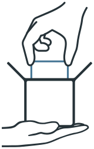

<p align="center">
  <picture>
    <source media="(prefers-color-scheme: dark)" srcset="assets/logo-packing-dark.svg">
    
  </picture>
</p>

# Experiment packaging, exchange, and installation

Create a `tar.xz` exchange archive from a stopped or completed experiment,
share it, inspect it, and install it into a new directory for another run.
Exchange archives carry module packages, the applied template, and static
resources. [Snapshots](restoration.md) serve runtime restoration.

## Create, inspect, and install an archive

For a stopped experiment, the CLI provides:

```text
uv run python -B cli.py archive create "<absolute-archive-path>" --wait
uv run python -B cli.py archive inspect "<absolute-archive-path>" --wait
uv run python -B cli.py archive install "<absolute-archive-path>" "<new-absolute-directory>" --wait
```

Archive paths and installation destinations belong to the server's machine.
Use `--config <cli-json>` or `--url <api-url>` before the subcommand to select
another server. Transfer the archive to that server before inspecting or
installing it there.

The runtime checks archive validity, space, and experiment state. Installation
registers the required module packages and installs the applied template and
static resources into the new directory. See
[archive commands](cli.md#snapshots-and-archives) and
[command modes](http_api.md#modes-and-commands) for requirements.

## Run the installed experiment

Follow the [experiment guide](basic_dag.md) to select the installed template
and start a run on a ready run-mode server. Command completion through `--wait`
does not mean that the resulting experiment has completed; inspect `status`.

The recipient still needs the dependencies, datasets, external services, and
environment documented by the module authors. Packaging makes the experiment
inputs transferable without guaranteeing identical results in every environment.
See [reproducibility and responsibility](reproducibility.md).

Return to [project features](../README.md#what-it-does) or the
[documentation index](README.md).
