<p align="center">
  
</p>

# Snapshots, rollbacks, and recovery

Save experiment state at a paused boundary, roll back to a saved state, recover
an interrupted experiment, or create a continuation from a valid snapshot.
The runner owns restoration policy; services implement saving and restoring
their actual state.

## Create a snapshot and roll back

With the experiment selected on a ready run-mode server, create a manual
snapshot at an idle pause:

```text
uv run python -B cli.py pause --wait
uv run python -B cli.py snapshot --label before-change --wait
```

Use the returned snapshot ID with `rollback <snapshot-id> --wait` to restore
the paused experiment. Rollback replaces experiment state and journal history;
clients must refresh their journal generation.

A snapshot must be fully valid before continuation or rollback. Snapshot
`list` and `inspect` read metadata; their `integrity: not_checked` does not prove
restorability. See [snapshot inspection](cli.md#browse-saved-experiments-and-snapshots).
Automatic snapshot settings and final snapshots are described in the
[template reference](experiment_template.md#snapshots-and-journal).

## Recover or continue

After a server interruption, inspect `health` and `status` for recovery
requirements, then use `recover <experiment-id> --wait`. Recovery reconciles the
existing experiment and any surviving participants. Do not treat a saved PID
or missing endpoint as proof that the old work has stopped.

`run --continue-from <experiment-id> --wait` creates a continuation from a valid
saved snapshot. It is different from reconnecting to a live participant.
Run these subcommands through `uv run python -B cli.py`; use `--config <cli-json>`
or `--url <api-url>` before the subcommand for another server.

See [interrupted runs and reload recovery](debugging.md#snapshots-and-interrupted-runs)
for troubleshooting and [CLI commands](cli.md#snapshots-and-archives) for syntax.

## What restoration depends on

Services must freeze actual writers, save all required state, and restore it
correctly. A rollback does not automatically undo external database writes,
network requests, or other effects outside saved state. See
[service state](instructions/python_bridges.md#settings-and-state) and
[author responsibilities](reproducibility.md).

For transferring module code, the applied template, and static resources for
another run, use [experiment packaging](packaging.md).

Return to [project features](../README.md#what-it-does) or the
[documentation index](README.md).
